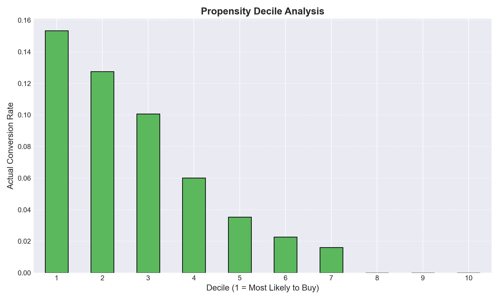
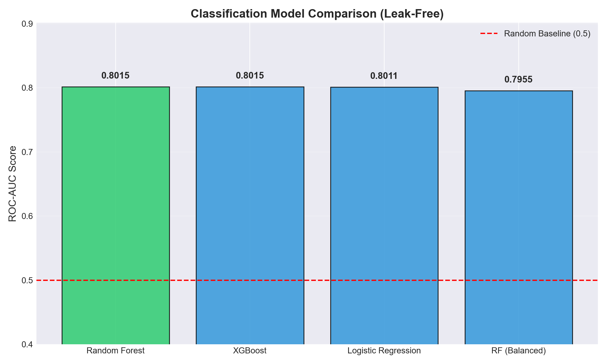

# Predictive Funnel Analytics (PFA-GA4)
### Which online shoppers are worth a nudge, and which ones should be left alone?

[](https://rynetroy-predictive-funnel-analytics-ga-appstreamlit-app-dcavuj.streamlit.app/)


**Troy Dela Rosa** | Independent academic project, Supervised Machine Learning (COMP-2704), RRC Polytech | Apr 2026
Built on a synthetic ecommerce dataset shaped like Google Analytics 4 (GA4) data: 100K customers, 2M+ website events.
For the full technical write-up, see the [README](README.md).

---

## The business problem

About 95% of online shopping visits end without a purchase. Most stores respond the same way to everyone: the same retargeting ads, the same discount codes, the same cart-reminder emails.

That wastes money in two directions:
- **Discounts go to people who were going to buy anyway**, which gives away margin for nothing.
- **Ad budget goes to people who were never going to buy**, which spends money with no return.

This project scores every visit so a marketing team can tell those groups apart and spend where it actually makes a difference.

---

## What I found

**1. Buyers are concentrated, and the model can find them.**
The top 10% of visits, as ranked by the model, converted at **15.3%**, about **3x** the store average of 5.2%. The bottom 30% almost never bought.



**2. What people do on the site tells you *if* they'll buy, not *how much*.**
Clicks, cart activity and time on site predicted whether someone would buy, but they predicted basket size no better than a simple average. How much someone spends is better estimated from what they've spent before.

> *Clicks signal intent. History signals wallet.*

**3. The best place to test a nudge is the middle.**
Visitors with very strong buying signals probably don't need a discount. Visitors with almost no signal probably won't respond to one. The middle group shows real interest but hasn't committed, and that's where a cart reminder or targeted offer is most worth testing.

**4. A score that ranks well isn't automatically a forecast.**
The raw model scores ranked visitors well but overstated how likely they were to buy (about 36% on average versus 5% in reality). I adjusted them so the numbers can be read as real likelihoods before using them for any revenue planning.

---

## What a business could do with it

| Group | Who they are | Suggested action |
|---|---|---|
| **High Certainty** (top 10%) | Strongest buying signals | Don't discount. Protect margin with reminders or reassurance instead |
| **At-Risk** (next 10%) | Interested but hesitating | Test cart-recovery emails or a targeted offer |
| **Monitor** (next 20%) | Some interest, not enough yet | Wait for a stronger signal before spending |
| **Low Interest** (bottom 60%) | Little sign of buying | Cut conversion-focused ad spend; keep in brand awareness |

The cut-off points are a business choice and can be moved to fit a team's budget or capacity.

**Who uses it:** marketing (who to retarget), pricing (who not to discount), CRM (who gets which message), and merchandising or inventory planning (early demand signals).

---

## How it works

```text
1. Score the visit       →  How likely is this visit to end in a purchase?
2. Estimate the basket   →  If they buy, how much will they likely spend? (from past purchases)
3. Combine and act       →  Likelihood × basket = expected value → group → recommended action
```

---

## Honest limits

- **The data is synthetic.** It shows the method works; it isn't evidence about a real store. Next step: rerun it on Google's public GA4 sample data.
- **It predicts, it doesn't prove.** The model shows where a nudge *might* help. Only an A/B test can show whether the nudge actually causes extra sales.
- **Revenue, not profit.** The data has no margin or discount costs, so it can't tell you which actions are profitable.
- **Revenue figures are being re-checked.** While reviewing my own work, I found the basket estimate was accidentally using information it shouldn't have had. The buyer-ranking results above aren't affected; the revenue numbers will be added back once the fix is rerun.

---

## Try it

**[Open the live demo](https://rynetroy-predictive-funnel-analytics-ga-appstreamlit-app-dcavuj.streamlit.app/)**: load the sample data to see each visit scored, grouped and paired with a recommended action, then download the results.

---

<details>
<summary><b>Technical details</b> (models, validation, design decisions, repo structure)</summary>

<br/>

### Results

| Metric | Result |
|---|---:|
| Sessions modeled | ~2.0M |
| Baseline conversion rate | 5.16% |
| Top decile conversion rate | 15.33% (3.0x lift) |
| ROC-AUC (XGBoost, test set) | 0.80 |
| Spend predicted from session behavior (R²) | ≈ 0 (no better than the average) |

### Model comparison

Four classifiers landed at the same ROC-AUC on validation, and tuning moved none of them by more than 0.01. The signal is in the features, not the algorithm.

| Model | ROC-AUC |
|---|---:|
| Random Forest | 0.8015 |
| XGBoost | 0.8015 |
| Logistic Regression | 0.8011 |
| Random Forest (balanced) | 0.7955 |



### Features

25 features (11 before one-hot encoding):
- **Behavioral:** session duration, event velocity, cart-to-view ratio, click-to-view ratio
- **Customer:** age, loyalty tier, acquisition channel, device type
- **Campaign:** channel, objective, expected uplift

### Validation

- 60/20/20 train, validation and test split, stratified, done before any encoding or imputation
- Leakage audit: an early model scored ROC-AUC 1.00; four rounds of feature removal brought it to 0.80
- Imputers and encoders fit on the training split only
- Platt scaling fit on validation, evaluated on test (ranking unchanged)
- Decile lift analysis and SHAP explainability, including a review of missed buyers
- Self-audit (Nov 2026): the spend lookup averaged each customer's full history, including the purchase being predicted (62% of customers have only one purchase), and the revenue reconciliation matched predictions to the wrong rows. Fixes in progress.

### Design decisions

**Two stages, because revenue is mostly zeros.** About 95% of sessions generate no revenue. Modeling it directly blends two questions, so the model answers them separately: will it convert, and if so, how much (a hurdle model).

**ROC-AUC and decile lift, not accuracy.** Predicting "no purchase" for everyone scores 95% accuracy. The baseline Random Forest did exactly that at the default threshold and found zero buyers.

**XGBoost kept, but not because it won.** All four models scored about 0.80. Logistic Regression would do the same job and is easier to explain.

**Leakage checks before trusting any score.** Removed, in order: the purchase event, all-time spend totals, time-gated spend history, and raw event counts (which rebuilt the funnel in this synthetic data). Still to fix: event velocity includes the purchase event.

**Spend from history, not behavior.** Session behavior had R² ≈ 0 for basket size. The corrected spend estimate uses only purchases made before each session.

**Calibrate before planning.** Raw scores averaged 35.9% versus 5.16% actual. Fine for ranking, misleading for revenue.

**Segments by rank, not fixed probability cut-offs.** After calibration few sessions exceed 40%, so fixed thresholds leave segments empty. Percentile cut-offs keep every group usable. (The demo app still uses the earlier thresholds and will be updated.)

### Before production use

GA4 BigQuery validation, cross-device identity, event quality checks, margin and discount costs, automated scoring, drift and calibration monitoring, and an A/B testing framework.

### Repository structure

```text
app/streamlit_app.py                     Streamlit demo
models/                                  Trained model, feature list, customer spend lookup
data/README.md                           How to download the raw Kaggle dataset
data/processed/scored_sample_sessions.csv
notebooks/data-audit.ipynb               Profiling of the raw tables
notebooks/01_modeling_pfa_ga4.ipynb      Full modeling notebook
notebooks/predictive-funnel-analytics-GA4-Stakeholder-Report.ipynb
reports/                                 Profiling reports per table
visualizations/                          Charts
```

### Run locally

```bash
git clone https://github.com/rynetroy/Predictive-Funnel-Analytics-GA4.git
cd Predictive-Funnel-Analytics-GA4
pip install -r requirements.txt
python -m streamlit run app/streamlit_app.py
```

The raw dataset (Marketing & E-Commerce Analytics Dataset, Kaggle) isn't included because of size; see `data/README.md`.

</details>
