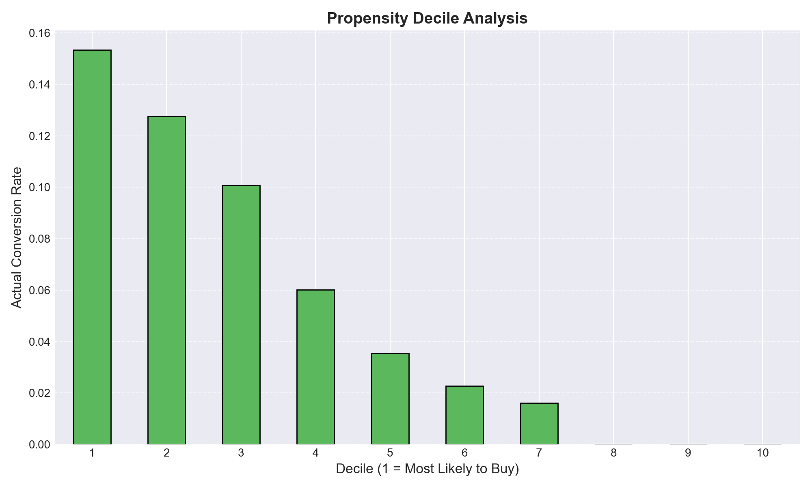
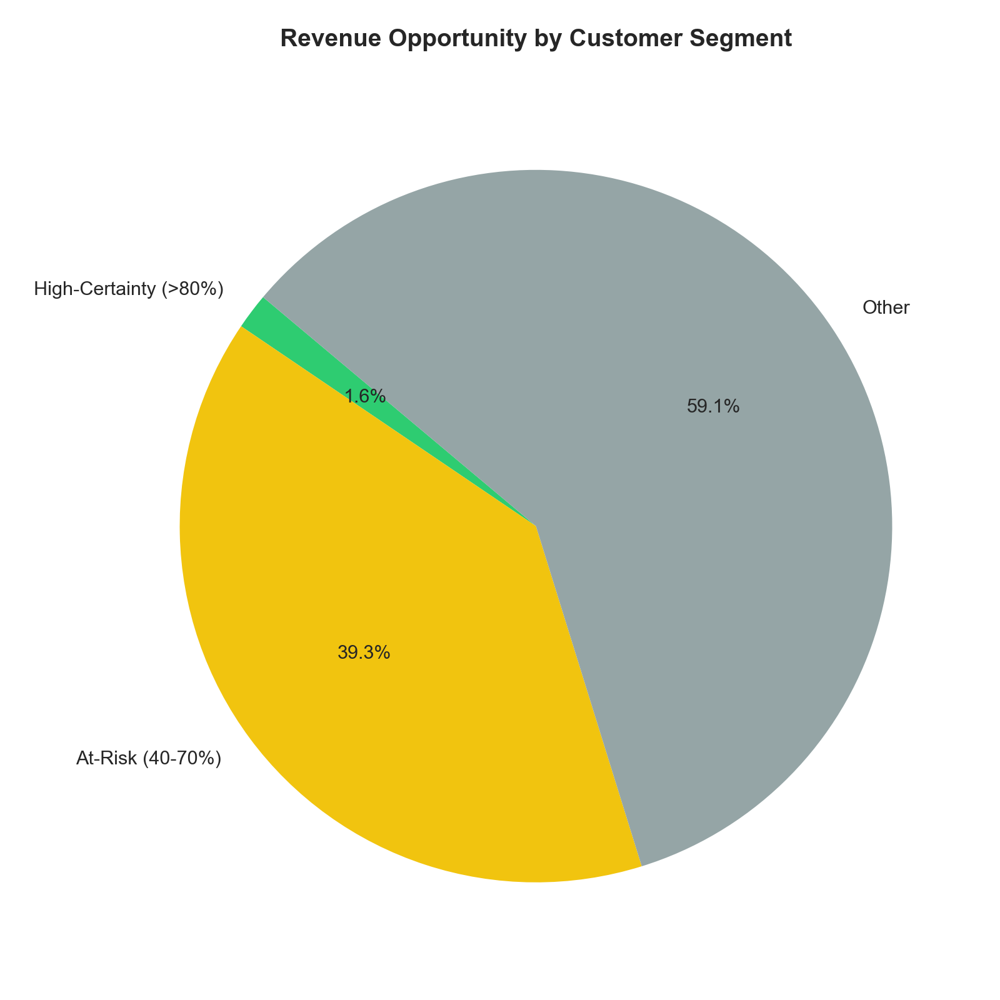

# Predictive Funnel Analytics for Ecommerce Revenue Prioritization
### A GA4-Aligned Analytics Project for Session Scoring, Revenue Opportunity, and Marketing Decision Support

**Repository:** [Predictive-Funnel-Analytics-GA4](https://github.com/rynetroy/Predictive-Funnel-Analytics-GA4)
**Live Demo:** [Launch the PFA-GA4 Streamlit App](https://rynetroy-predictive-funnel-analytics-ga-appstreamlit-app-dcavuj.streamlit.app/)


**Author:** Troy Dela Rosa
**Tools:** Python, pandas, scikit-learn, XGBoost, SHAP, Streamlit
**Dataset:** Synthetic, GA4-structured. See [Data & Scope](#data--scope).

---

## Overview

Most ecommerce models focus on one question:

> **Will this customer buy?**

This project asks a different question:

> **What is this session worth, and what should the business do about it?**

PFA-GA4 uses a two-stage scoring approach:

**Conversion Probability × Predicted Spend = Expected Revenue**

The goal is to rank GA4-style ecommerce sessions by potential value and connect those scores to practical business actions.

The underlying dataset is synthetic. The results in this README demonstrate how the framework works and should not be interpreted as production results. The data structure and scoring approach are designed to map to a real GA4 BigQuery export.

### Results at a Glance

| Metric | Result |
|---|---:|
| Baseline conversion rate | 5.16% |
| Top decile conversion rate | 15.33% |
| Lift, top decile vs. baseline | 3.0x |
| ROC-AUC (conversion model) | 0.80 |
| Calibrated expected revenue (test set) | $1.97M |
| Actual test-set revenue | $1.74M |
| Revenue variance after calibration | +13.4% |



---

## Business Context

Ecommerce teams can see how much traffic they receive, but traffic volume alone does not tell them which sessions deserve attention.

Some visitors are already highly likely to purchase. Others show some buying intent but may need additional engagement. Some sessions have very little indication of purchase intent.

The goal of this project is to separate those groups and give marketing, pricing, CRM, and analytics teams a way to prioritize sessions based on **expected revenue**, rather than relying only on traffic volume or conversion probability.

```text
Behavior → Revenue → Business Action
```

---

## Key Insights

### 1. Conversion opportunity is concentrated

The top 10% of ranked sessions converted at 15.33%, compared with a 5.16% overall conversion rate.

That is approximately 3.0x the baseline conversion rate.

This suggests that purchase intent is concentrated within a relatively small portion of sessions. Instead of treating every visitor the same, marketing teams could focus attention on the sessions showing the strongest signals.

**Business takeaway:** prioritize retargeting and other conversion-focused activity toward higher-value sessions instead of spreading resources evenly across all traffic.

### 2. Conversion probability is not the same as revenue opportunity

A session with a high probability of converting is not necessarily the most valuable session.

For example, a customer with a 70% chance of purchasing a $20 order may be less valuable than a customer with a 50% chance of purchasing a $200 order.

PFA-GA4 combines purchase intent with predicted customer spend:

```text
Expected Revenue = P(Conversion) × Predicted Spend
```

The conversion model uses session behavior such as pages viewed, session duration, cart activity, traffic source, and funnel stage.

Predicted spend comes from customer history, including previous order value, purchase frequency, and recency.

This separates two different signals:

- **Session intent:** what the customer is doing right now
- **Customer value:** what the customer has historically spent

**Business takeaway:** ranking sessions by expected revenue can provide a different prioritization than ranking by conversion probability alone.

### 3. The middle of the funnel is the strongest testing opportunity

Sessions with very high purchase probability may not need a discount or additional incentive. Offering a discount to someone who was already likely to buy could simply reduce margin.

At the other end, sessions with very weak signals may not be worth spending additional conversion-focused budget on.

The middle segment is more interesting. These sessions show meaningful intent but are not yet highly committed. They could be candidates for testing actions such as:

- Cart recovery
- Personalized messaging
- Limited-time offers
- Product recommendations
- Retargeting

The model does not claim that these actions will increase conversion. That would require controlled A/B testing.



### 4. Calibration matters before using model scores for planning

The raw model probabilities initially overstated expected revenue.

After applying Platt scaling, calibrated expected revenue was $1.97M compared with $1.74M in actual test-set revenue.

That represents a 13.4% variance.

| Revenue Measure | Amount |
|---|---:|
| Calibrated expected revenue | $1.97M |
| Actual test revenue | $1.74M |
| Variance | +$233K (+13.4%) |

Calibration does not make the model perfect, but it provides a more realistic basis for using predicted probabilities in revenue planning and prioritization.

---

## Business Segmentation Framework

| Segment | Meaning | Recommended Action | Primary Stakeholder |
|---|---|---|---|
| High Certainty | Strong likelihood to convert | Protect margin and avoid unnecessary discounts | Marketing, Pricing |
| At-Risk | Moderate intent and strongest testing opportunity | Test selective incentives or recovery messaging | Marketing, CRM |
| Monitor | Some signal but not yet actionable | Wait for stronger behavioral signals | Digital Analytics |
| Low Interest | Weak intent and low wallet potential | Reduce conversion-focused ad spend | Paid Media, Growth |

---

## How It Works

### Stage 1: Conversion Propensity

An XGBoost classifier predicts the probability that a session will result in a purchase.

The model uses session-level behavioral features such as:

- Pages per session
- Session duration
- Cart additions
- Traffic source
- Funnel stage

XGBoost was compared with Logistic Regression and Random Forest. The final model achieved a test-set ROC-AUC of 0.80 and showed stronger decile ranking performance.

### Stage 2: Spend Estimation

The second stage estimates potential customer spend using a customer-level lookup:

```text
models/customer_spend_lookup.csv
```

The lookup is based on historical customer behavior such as:

- Previous order value
- Purchase frequency
- Recency

This allows the project to separate session intent from customer spending history.

### Stage 3: Scoring and Segmentation

The two stages are combined to calculate expected revenue:

```text
Expected Revenue = P(Conversion) × Predicted Spend
```

Sessions are then ranked and assigned to one of four business segments based on conversion likelihood and potential customer value.

*A direct comparison between expected-revenue ranking and conversion-probability ranking is an important next validation step. This will help determine how much additional ranking value the spend-estimation stage provides.*

---

## Model Validation

The project includes several validation steps:

- Train, validation, and test split
- Leakage checks before finalizing features
- Model comparison between Logistic Regression, Random Forest, and XGBoost
- Probability calibration using Platt scaling
- Decile lift analysis
- SHAP explainability
- Revenue reconciliation against the actual test set
- Planned comparison of expected-revenue ranking versus conversion-probability ranking

---

## Design Decisions

Each choice below is one I'd expect to be asked about, so here is the reasoning behind it.

**Rank by expected revenue, not conversion probability alone.**
Probability answers "who will buy?" Expected revenue answers "which session is worth acting on?", which is the question a marketing team actually has. Whether this ranking beats probability alone on this data has not been tested yet; that comparison is the next validation step listed above.

**Two stages: session behavior for intent, customer history for spend.**
What someone does in a session (pages, duration, cart activity, funnel stage) signals how ready they are to buy. What they have spent before signals how much they are likely to spend. Keeping the two separate means each signal can be checked and improved on its own, and the ranking can explain which one drove a score.

**Judged on ROC-AUC and decile lift, not accuracy.**
Only 5.16% of test sessions converted. A model that predicts "no purchase" for everyone would be about 95% accurate and useless. ROC-AUC measures how well the model ranks buyers above non-buyers, and decile lift shows whether the top of the ranking really converts more.

**XGBoost over Logistic Regression and Random Forest.**
All three were compared. XGBoost was selected because it showed the strongest decile ranking and the highest ROC-AUC. Logistic Regression stayed useful as a simple baseline to confirm the extra complexity was worth it.
<!-- [CONFIRM] Add each model's ROC-AUC from 01_modeling_pfa_ga4.ipynb, e.g. "LogReg 0.XX, RF 0.XX, XGBoost 0.80". -->

**Leakage checks before trusting any score.**
Features that would only be known after a purchase can make a model look excellent in testing and fail in real use. These were checked and removed before finalizing the feature set, and the test set was kept separate from both training and calibration.
<!-- [CONFIRM] Name the feature(s) removed for leakage and the split ratio (e.g. 70/15/15). -->

**Spend history built only from purchases before the session.**
If the spend lookup included the order from the session being scored, the spend estimate would already "know" the outcome. The lookup has to use only history that existed before each session.
<!-- [CONFIRM] Check customer_spend_lookup.csv: is it built from pre-session history only? If not, delete this decision and note it as a known limitation instead. -->

**Calibrate probabilities with Platt scaling.**
The raw scores ranked sessions well but overstated probabilities, which would inflate any revenue plan built on them. Platt scaling, fit on the validation set, adjusts the scores to behave like real likelihoods. The result (+13.4% vs actual) is close enough for prioritization, not for a budget forecast.
<!-- [CONFIRM] If you compared Platt scaling with isotonic regression, say why you picked Platt. -->

**Four action segments instead of one cutoff.**
A single "buy / won't buy" threshold hides the most useful group: mid-propensity sessions that show intent but may still need a nudge. Four segments give each team a clear action, including the one most models miss: not discounting customers who would buy anyway.

**Stop at expected revenue, not expected profit.**
The dataset has no margin, shipping or discount cost, so profit can't be estimated honestly. That is the first change before real use, along with an A/B test, because the model shows where action may pay off but does not prove the action causes extra sales.

**Synthetic data with a GA4 structure.**
A synthetic dataset shaped like GA4 event data means the workflow (events to sessions to scores) could later be pointed at a real GA4 BigQuery export. The results show the method works on this data; they are not evidence about any real store.

---

## Data & Scope

The dataset is synthetic and structured to resemble a GA4 BigQuery export.

The intended data flow is:

```text
Event Logs
    ↓
Session Aggregation
    ↓
User / Session Keys
    ↓
Attribution Metrics
    ↓
Transaction Value
    ↓
Predictive Scoring
```

This project is a ranking and prioritization prototype. It demonstrates how a scoring framework could work with GA4-style ecommerce data, but it has not been validated against a real GA4 BigQuery export.

There are also several important limitations:

- The dataset is synthetic
- The model ranks sessions but does not prove causal impact
- Recommended interventions require A/B testing to measure incremental lift
- Expected revenue is not the same as expected profit
- Margin, shipping costs, and discount costs are not currently included

### Before Production Use

A production implementation would need:

- Validation against native GA4 BigQuery event tables
- Cross-device identity resolution
- Event quality checks
- Attribution rules
- Product margin and discount-cost integration
- Automated scoring and monitoring
- Model drift monitoring
- An experimentation framework to measure incremental lift

---

## Repository Structure

```text
Predictive-Funnel-Analytics-GA4/
│
├── app/
│   └── streamlit_app.py
│
├── models/
│   ├── pfa_ga4_propensity_model.joblib
│   ├── feature_names.joblib
│   └── customer_spend_lookup.csv
│
├── data/
│   └── processed/
│       └── scored_sample_sessions.csv
│
├── notebooks/
│   ├── 01_modeling_pfa_ga4.ipynb
│   ├── 02_deployment_prep.ipynb
│   └── predictive-funnel-analytics-GA4-Stakeholder-Report.ipynb
│
├── visualizations/
│   ├── header.png
│   ├── streamlit_app_demo.png
│   ├── propensity_decile.png
│   └── revenue_opportunity.png
│
├── README.md
├── requirements.txt
└── .gitignore
```

---

## Try It Yourself

### Option 1: Review the Scored Sample

Open:

```text
data/processed/scored_sample_sessions.csv
```

Sort the data by `expected_revenue` and compare the highest- and lowest-ranked sessions.

Look for:

- Conversion probability differences
- Predicted spend differences
- Expected revenue differences
- Conversion concentration among highly ranked sessions

### Option 2: Run the Streamlit App

```bash
git clone https://github.com/rynetroy/Predictive-Funnel-Analytics-GA4.git
cd Predictive-Funnel-Analytics-GA4
pip install -r requirements.txt
python -m streamlit run app/streamlit_app.py
```

The app will open at:

```text
http://localhost:8501
```

Load the sample data, review session scoring and segmentation, and download the scored output.

The app expects the feature set listed in:

```text
models/feature_names.joblib
```

The included sample CSV is already formatted correctly. If you upload your own data, the app will flag any missing required columns.

---

## Stakeholder Use Cases

| Stakeholder | How This Helps |
|---|---|
| Marketing | Prioritize retargeting and cart-recovery audiences by expected value |
| Pricing | Suppress promotional discounts on high-certainty traffic to protect margin |
| Merchandising | Surface category demand signals from session behavior |
| CRM | Identify segments for personalized lifecycle messaging |
| Ecommerce Analytics | Provide a repeatable scoring layer for session-level decisions |
| Operations Planning | Provide demand signals that can complement inventory and replenishment planning |

---

## From Score to Decision

PFA-GA4 connects the model to a business decision:

```text
Probability × Spend
        ↓
Expected Revenue
        ↓
Session Ranking
        ↓
Business Segment
        ↓
Recommended Action
```

The goal is not simply to predict who might buy.

It is to help answer:

> Where should the business focus its attention, and why?

**Clicks signal intent. History signals wallet.**
